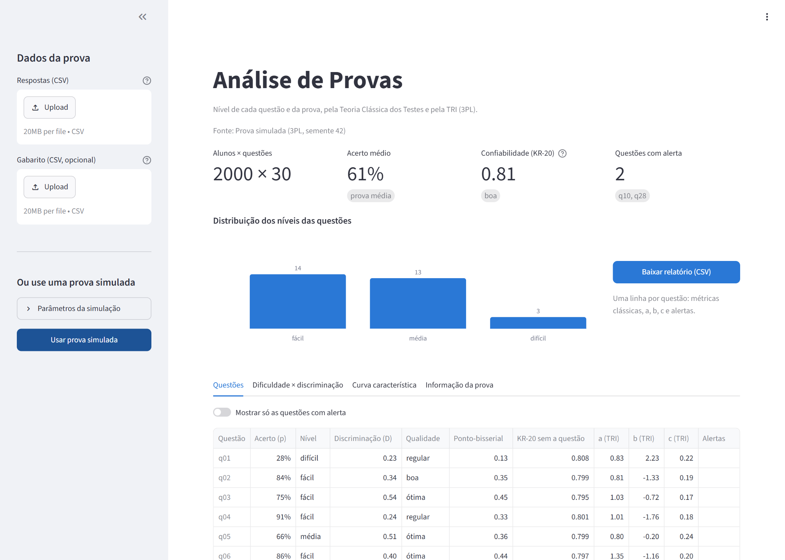
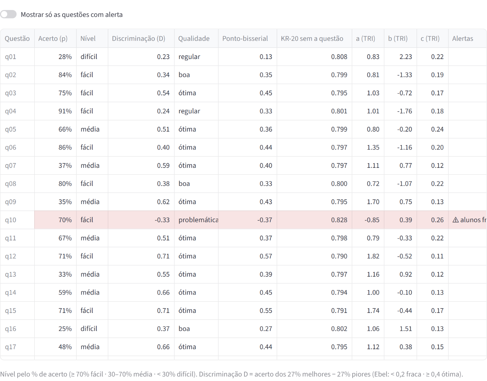
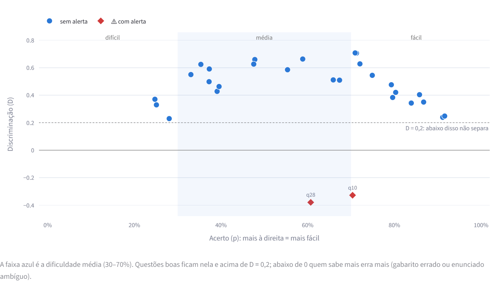
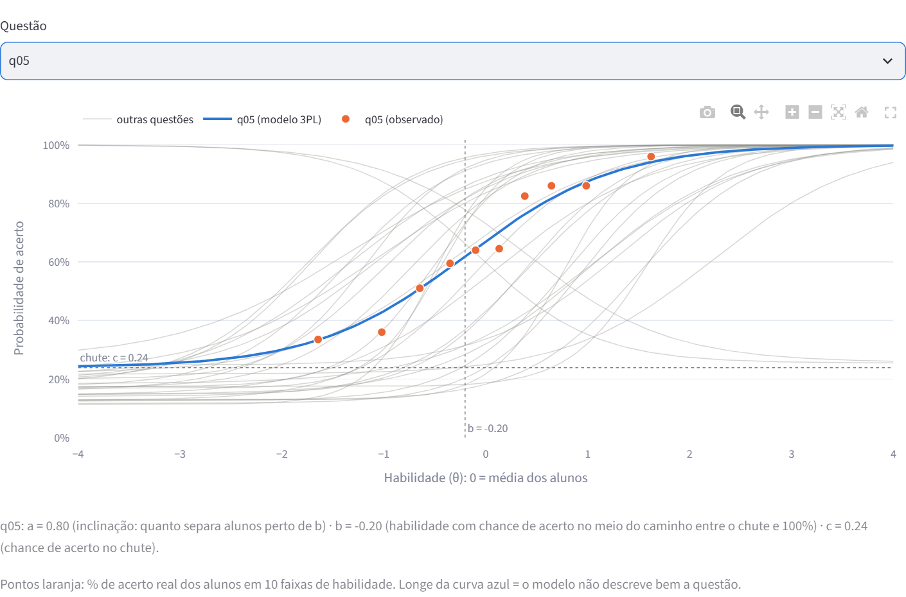
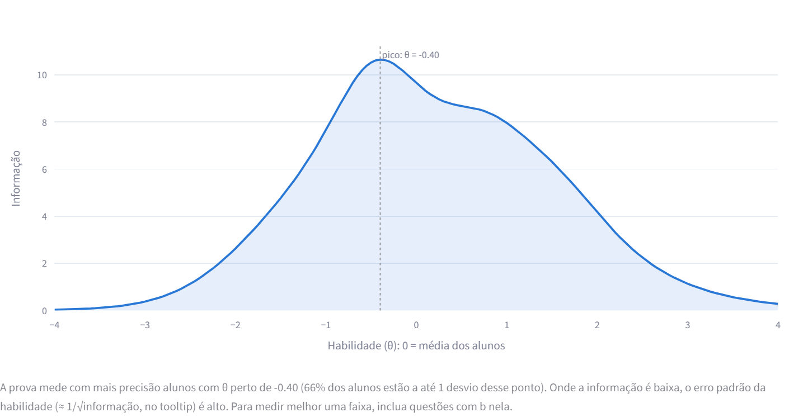
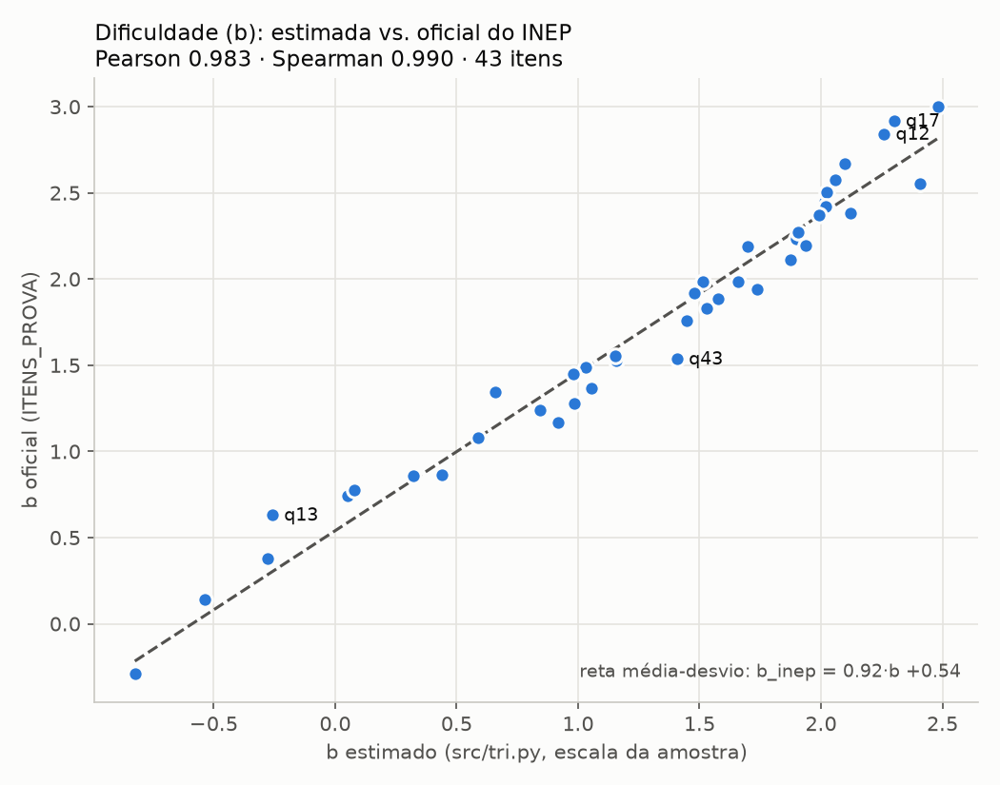
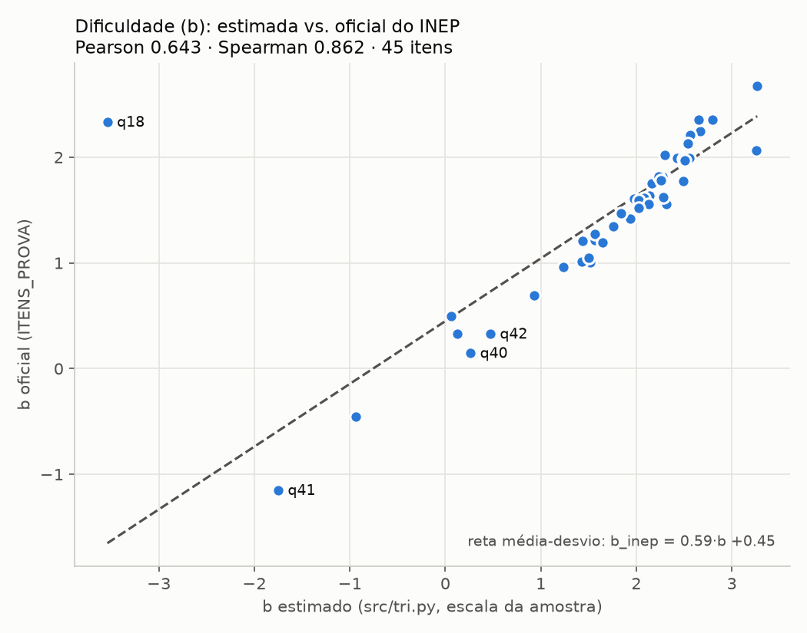
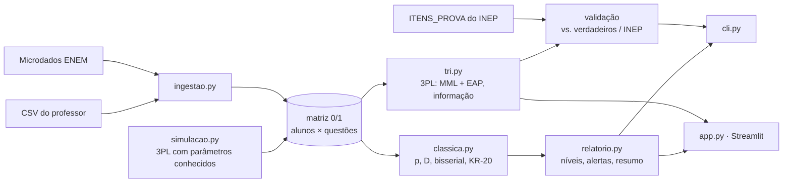

# Análise de Provas

**Mede o nível de cada questão e da prova a partir das respostas dos alunos**, pela Teoria Clássica dos Testes e pela Teoria de Resposta ao Item (TRI, modelo de 3 parâmetros, o mesmo do ENEM). Tem um app web para professores e uma CLI que roda sobre os microdados do ENEM. A TRI, implementada do zero, foi validada contra os parâmetros oficiais do INEP.

<!-- Depois do deploy no Streamlit Community Cloud, coloque o link do app aqui. -->



## O problema

Uma prova só mede bem se as questões forem boas. Na prática, o professor corrige a prova e olha a nota, mas não sabe responder:

- **Quais questões estavam fáceis ou difíceis demais** para a turma?
- **Quais não separam** quem sabe de quem não sabe?
- **Alguma questão tem gabarito errado ou enunciado ambíguo?** O sinal disso é que os alunos mais fortes erram mais que os fracos.
- **A prova como um todo é confiável?** Para que nível de aluno ela mede melhor?

A psicometria responde a essas perguntas há décadas. O INEP usa a TRI para corrigir o ENEM. Mas as ferramentas (BILOG, pacotes de R) são pouco acessíveis para quem não é especialista. Este projeto leva as mesmas análises para um CSV de respostas e um navegador.

## O que o app mostra

Envie as respostas e o gabarito em CSV, ou clique em **Usar prova simulada**. O app calcula tudo e mostra:

- **Painel da prova:** acerto médio, confiabilidade (KR-20), quantas questões são fáceis, médias e difíceis, e quais têm alerta.
- **Tabela de questões** com nível, discriminação, parâmetros da TRI e alertas destacados. A q10 abaixo foi gerada com discriminação negativa, e o app a encontra:

  

- **Dificuldade × discriminação:** a questão ideal fica na faixa média e acima de D = 0,2. As questões problemáticas aparecem isoladas embaixo:

  

- **Curva característica de cada questão:** a curva do modelo (azul) junto com o acerto *observado* em 10 faixas de habilidade (laranja), para conferir se o modelo descreve bem a questão:

  

- **Curva de informação da prova:** para que nível de aluno a prova mede com mais precisão:

  

- **Relatório em CSV** para baixar, com uma linha por questão.

## Como funciona

Toda fonte de dados (CSV do professor, microdados do ENEM ou prova simulada) vira uma **matriz 0/1 de alunos × questões**. Todas as análises partem dela.

### Teoria Clássica dos Testes

| Métrica | O que mede | Leitura |
|---|---|---|
| Dificuldade (p) | % de alunos que acertou | ≥ 70% fácil · 30–70% média · < 30% difícil |
| Discriminação (D) | acerto dos 27% melhores − acerto dos 27% piores (Kelley) | < 0 problemática · < 0,2 fraca · ≥ 0,4 ótima (Ebel) |
| Ponto-bisserial | correlação da questão com a nota no resto da prova | confirma o D |
| KR-20 sem a questão | confiabilidade da prova se a questão saísse | se sobe, a questão atrapalha |

Os alertas são automáticos: discriminação negativa (provável gabarito errado ou enunciado ambíguo), questão que não separa os alunos, quase todos acertam ou quase todos erram, e questão que derruba a confiabilidade.

### TRI: modelo logístico de 3 parâmetros

$$P(\text{acerto} \mid \theta) = c + \frac{1 - c}{1 + e^{-1{,}7\,a\,(\theta - b)}}$$

- **b** é a dificuldade, na escala da habilidade θ.
- **a** é a discriminação, a inclinação da curva. Fica negativo quando quem sabe mais erra mais.
- **c** é a chance de acerto no chute.

O `src/tri.py` estima o modelo **sem bibliotecas de TRI**, pelo mesmo método do BILOG que o INEP usa:

- **Questões:** máxima verossimilhança marginal. A habilidade θ ~ N(0, 1) é integrada numa grade de 41 pontos. A otimização é feita pelo L-BFGS-B (scipy), com gradiente analítico, que equivale ao EM de Bock–Aitkin. Há priors fracos em b ~ N(0, 2) e c ~ Beta(5, 17), como no BILOG, para o 3PL não divergir.
- **Alunos:** EAP (média da posterior), com erro padrão. Existe mesmo para quem acertou ou errou tudo.
- **Informação de Fisher** por questão e da prova. O erro padrão de θ é ≈ 1/√informação.

## Validação

### 1. Prova simulada: o sistema recupera a "verdade"?

O `src/simulacao.py` gera respostas pelo 3PL com habilidades e parâmetros **conhecidos**, e inclui questões defeituosas (a < 0). Com 2 000 alunos, 30 questões e 2 defeituosas (`seed=42`):

| O que foi medido | Correlação com o valor verdadeiro |
|---|---|
| b estimado pela TRI | **0,997** |
| a estimado pela TRI | 0,913 |
| c estimado pela TRI | 0,693 |
| θ dos alunos (EAP) | 0,936 |
| % de acerto clássico × b | −0,969 |
| Índice D clássico × a | 0,385 |

- **As 2 questões defeituosas são detectadas** pelas duas teorias: D < 0 e a < 0.
- Com 10 000 alunos e 45 questões, o a sobe para 0,974 e o b para 0,998. O **c continua em ~0,64**. Ele é o parâmetro mais difícil de estimar, porque depende de haver muitos alunos de habilidade baixa para cada questão.
- O D clássico correlaciona pouco com o a porque também depende da dificuldade: uma questão muito fácil ou muito difícil tem D baixo mesmo discriminando bem. É uma limitação da teoria clássica que a TRI resolve.

### 2. ENEM 2023: comparação com os parâmetros oficiais do INEP

O INEP publica os parâmetros a, b e c de cada item no `ITENS_PROVA_2023.csv`. O teste aqui é estimar esses parâmetros só a partir das respostas, sem nenhuma informação do INEP, e comparar.

**Como foi feito:**
- Usei uma amostra de 10 000 participantes presentes do caderno mais comum de cada área (`seed=42`).
- A ligação item ↔ questão segue a ordem de `CO_POSICAO`. Itens anulados ficam de fora.
- O INEP calibra numa escala própria e o `tri.py` na escala da amostra (média 0, desvio 1). Por isso a comparação é pela **correlação**. A conversão linear (b_INEP ≈ A·b + B) serve só para o gráfico e o RMSE.

| Área | Caderno | Itens | **b** Pearson | **b** Spearman | a Pearson | c Pearson | θ × nota oficial |
|---|---|---|---|---|---|---|---|
| Matemática | 1213 | 43 (2 anulados) | **0,983** | **0,990** | 0,695 | 0,715 | 0,974 |
| Ciências Humanas | 1194 | 45 | **0,936** | **0,964** | 0,893 | 0,277 | 0,985 |
| Ciências da Natureza | 1223 | 45 | 0,643 | 0,862 | 0,488 | 0,871 | 0,945 |
| Ciências da Natureza **sem a q18** | 1223 | 44 | **0,979** | **0,974** | 0,798 | — | — |

<p>
  
  
</p>

**Leitura:**

- **A dificuldade (b), que é o que define o nível das questões, bate com a do INEP:** correlação de 0,94 a 0,98 nas três áreas, depois de explicado o item atípico de Natureza. A habilidade estimada dos alunos correlaciona de 0,94 a 0,99 com a nota oficial do ENEM.
- **O a e o c batem menos, e isso é esperado.** No 3PL, os dois se compensam: uma curva com chute maior e inclinação maior descreve dados parecidos com uma de chute menor e inclinação menor. Os priors do `tri.py` não são os do INEP, e o INEP calibra com a população inteira e mantém a escala ligada à de edições anteriores. Em Humanas, por exemplo, o `tri.py` estima c menor (0,15 contra 0,18) e, junto, a menor.
- **A q18 de Natureza é um item que o 3PL não descreve.** O acerto *cai* com a habilidade, até que um grupo pequeno do topo acerta quase sempre:

  | Faixa de nota oficial (CN) | 0–10% | 30–50% | 70–90% | 90–95% | 99–99,9% | top 0,1% |
  |---|---|---|---|---|---|---|
  | Acerto na q18 | 17% | 14% | 8% | **7%** | 30% | **91%** |

  É o padrão de um **distrator forte**: uma alternativa errada que atrai justamente os alunos bons, mas não os excelentes. Como o 3PL só desenha curvas que sobem, cada estimação ajusta um pedaço dessa curva:
  - O INEP ajusta o salto no topo: a = 5,9 e b = 2,3, uma questão difícil e muito discriminativa.
  - O `tri.py` ajusta a queda, que vale para 95% dos alunos, e devolve a < 0. O app marcaria a questão para revisão.

  Confirmei que não é erro de alinhamento: o acerto clássico de toda a prova correlaciona −0,88 com o b oficial. Também não é falta de dados: o resultado se repete com 100 000 alunos. E a solução com a < 0 tem verossimilhança maior que a solução com a > 0 no modelo do `tri.py`, mesmo abrindo o limite do a de 4 para 8.

Os resultados por item ficam em `saida/<área>/validacao_inep.csv`. Veja [Como reproduzir](#reproduzir-a-validação-do-inep).

## Arquitetura



```
app.py              # app web (Streamlit + plotly): só interface, toda a análise vem de src/
src/
├── ingestao.py     # ENEM e CSV → matriz 0/1; parâmetros oficiais do INEP (ITENS_PROVA)
├── simulacao.py    # gerador de provas pelo 3PL, com parâmetros verdadeiros conhecidos
├── classica.py     # dificuldade, discriminação, ponto-bisserial, KR-20
├── tri.py          # 3PL: a, b, c por MML; θ por EAP; informação; comparação com o INEP
├── relatorio.py    # níveis, alertas, resumo, saída; gráfico b × INEP
└── cli.py          # comandos: simular | csv | enem | tri
tests/              # pytest: funções de src/ e o app (streamlit AppTest)
exemplos/           # prova de 12 alunos × 6 questões (a q6 tem problema de propósito)
docs/img/           # prints do README
```

- **Stack:** Python 3.12, pandas, numpy, scipy, Streamlit, plotly, matplotlib.
- **Qualidade:** 38 testes com pytest e lint/formatação com ruff, com type hints exigidos. O CI (GitHub Actions) roda tudo isso em todo push.
- Os testes do app sobem a página de verdade com `streamlit.testing`.
- A validação do INEP tem testes com microdados e `ITENS_PROVA` sintéticos, gerados com uma escala conhecida.

## Como rodar

### App web

```bash
docker compose up -d app          # http://localhost:8501 · parar: docker compose down
```

Sem Docker:

```bash
python -m venv .venv && source .venv/bin/activate    # Windows: .venv\Scripts\activate
pip install -r requirements.txt
streamlit run app.py
```

Formato dos arquivos (o app tem uma prova de exemplo para baixar):

```csv
aluno,q1,q2,q3        questao,gabarito
a01,A,C,B             q1,A
a02,A,B,D             q2,C
                      q3,B
```

O primeiro é o `respostas.csv` e o segundo é o `gabarito.csv`. O gabarito é opcional: sem ele, as respostas precisam vir já corrigidas, em 0/1.

### Deploy no Streamlit Community Cloud

O app não depende de `data/` nem de `saida/`.

- O `requirements.txt` tem só as dependências de execução, com teto na próxima versão major.
- O `.streamlit/config.toml` limita o upload a 20 MB e esconde o menu de desenvolvedor.

Passos:
1. Suba o repositório para o GitHub.
2. Em <https://share.streamlit.io>, clique em **Create app** e escolha o repositório, a branch e o arquivo principal `app.py`.
3. Em **Advanced settings**, escolha **Python 3.12**, a mesma versão do Docker e do CI.

### CLI

```bash
docker compose build
docker compose run --rm analise simular                 # teoria clássica na prova simulada + validação
docker compose run --rm analise tri                     # TRI na prova simulada + validação
docker compose run --rm analise csv exemplos/respostas_exemplo.csv --gabarito exemplos/gabarito_exemplo.csv
docker compose run --rm analise enem data/MICRODADOS_ENEM_2023.csv --area MT --alunos 10000
```

Os resultados vão para `saida/`: `itens.csv`, `prova.json`, `itens_tri.csv` e, na validação, `validacao_inep.csv` e `b_vs_inep.png`.

### Reproduzir a validação do INEP

1. Baixe os microdados do ENEM 2023 em <https://www.gov.br/inep/pt-br/acesso-a-informacao/dados-abertos/microdados/enem>. O zip tem 550 MB.
2. Copie `DADOS/MICRODADOS_ENEM_2023.csv` (1,8 GB) e `DADOS/ITENS_PROVA_2023.csv` para `data/`.
3. Rode, para cada área (`MT`, `CN` ou `CH`):

   ```bash
   docker compose run --rm analise tri --enem data/MICRODADOS_ENEM_2023.csv \
       --itens data/ITENS_PROVA_2023.csv --area MT --alunos 10000 --saida saida/MT
   ```

Notas:
- O arquivo é lido em pedaços, só com as colunas da área. Leva alguns minutos por área.
- Cada cor de caderno tem as questões em outra ordem, então a análise usa o caderno mais comum. Para escolher outro, use `--caderno`.
- Linguagens (LC) fica de fora porque as 5 primeiras questões dependem da língua estrangeira.

### Testes e lint

```bash
docker compose run --rm testes      # pytest
docker compose run --rm lint        # ruff check + ruff format --check
```

## Limitações

- **O 3PL supõe que o acerto sobe com a habilidade.** Itens com distrator forte, como a q18 acima, violam isso. A curva empírica do app (pontos laranja) existe para mostrar esses casos.
- **Com poucos alunos, a TRI é instável.** Abaixo de 500 alunos o app avisa, e o ideal é ter 1 000 ou mais. Em provas de uma turma, a teoria clássica é o resultado mais confiável. No CSV de exemplo (12 alunos), vários `a` batem no limite do modelo.
- **O c é o parâmetro menos preciso**, tanto na simulação quanto contra o INEP.
- **Uma dimensão só:** o modelo supõe que a prova mede uma única habilidade.
